# 4 实验（Experiments）

> 本章按 E0–E9 报告全部实验。每项含：目的、协议、数据表、判定与对创新点的支撑。所有数字与 `code/results/e*/summary.json` 一致。
> **核心结论**：整数阈值搬运（C1）与整数判决层（C2）在真实定点板上使误警率契约按构造成立——搬运后 $P_{fa}$ 贴近 $\alpha$、漂移被 Prop.2 界覆盖、40 min 连续负载下 P99 跨窗极差 0.69%（INT8）/1.76%（FP16）（无热稳态劣化）、粗糙海况候选负载降 4.7–4.9×、检测兼容性无损。

---

## 4.1 实验设置

### 4.1.1 平台与软件栈

| 项 | 值 |
|---|---|
| 开发板 | Atlas 200I DK A2（单板，非集群）[17] |
| NPU | Ascend 310B |
| 推理框架 | ACL，batch=1，预热 50 / 测 500 |
| CANN | 7.0.RC1 |
| PTQ | AMCT / modelslim [18]（ONNX 末端 Dequant + `_scale.json`） |
| 编译 | ATC，输入 NCHW $1{\times}3{\times}640{\times}640$ |
| 浮点基线 | ONNX-Runtime INT8 / FP32（x86 交叉核对） |

> **单板纪律**：跨实现对照用 {同 `.om` 重复运行, ONNX-Runtime INT8, FP32} 三点，显式标注平台差异，不冒充多板实测。
> **遥测说明**：E7 批次经 npu-smi 采得功率 9.31 W；E6 批次 npu-smi 遥测字段缺失（CANN 7.0.RC1 对 310B 不提供温度/频率/功率读数），E6 以时延列（$T_{model}$/P99）佐证无降频。两处不可混用，本文按批次如实标注。

### 4.1.2 模型与量化配置

| 项 | 值 |
|---|---|
| 检测器 | YOLO11n [7]，单类 ship，SSDD 基线 [1] |
| 输入 | $640{\times}640$，归一化 |
| 输出头 | 3 个 $\mathrm{cv3}.\{0,1,2\}$（cell 数 6400/1600/400） |
| 量化节点数 | 88（含三个输出头） |
| INT8 OM 输出 dtype | float32（末端 Dequant，与 FP16 同 dump 链路） |
| 量化 OM | FP16 / INT8（基线）/ INT8-calmA / INT8-roughB（E5 设置1） |

### 4.1.3 数据与三套分离集合

| 集合 | 构造 | 规模 |
|---|---|---|
| SSDD 主集 | 官方 928 train / 232 test（尾号 1/9 协议） | test 232 图，$640{\times}640$ |
| $C_{\mathrm{quant}}$ | 三海况各 $\ge 64$ 张分层 | 与 $\Omega_{\mathrm{clutter}}$ 分离 |
| $\Omega_{\mathrm{clutter}}$ | GT 框外扩 $g{=}8$ px + 无目标裁片，块抽样 $B{=}64$ px | 求 $\lambda$ |
| $\Omega$ | 与 $\Omega_{\mathrm{clutter}}$ 不同构造 | $n_{\mathrm{meas}}=949703$ |
| E5 校准集 A/B | calm-256 / rough-256（不同海况比例） | 各 256 图 |

Fig.8 以单场景给出上述构造的直观图示：GT 框外扩 $g{=}8$ px 邻域（红）从测量集剔除，64 px 块抽样按 keep=0.5 构成标定池 $\Omega_{\mathrm{cal}}$（灰），其余单元构成测量集 $\Omega_{\mathrm{meas}}$（蓝）。

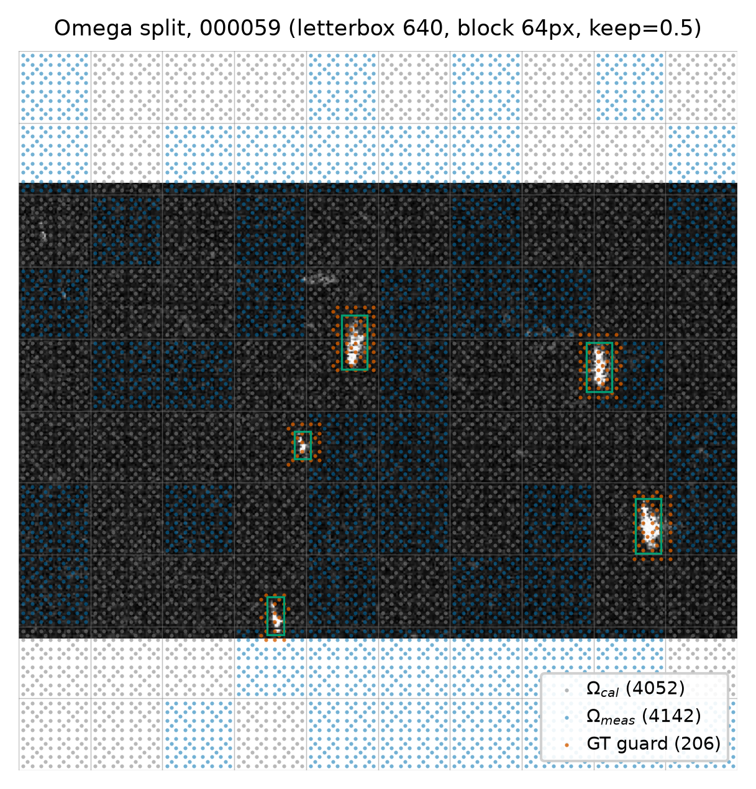{width=11cm}

### 4.1.4 全局审计参数与验收标准

| 参数 | 值 |
|---|---|
| 名义虚警率 $\alpha$ | $10^{-3}$（主），$10^{-4}$（E8 附加） |
| keep / guard / block | 0.5 / 8 px / 64 px |
| bootstrap | 场景级 1000 次 → 95% CI |
| **R 判据（两级，全文统一）** | 存在性门 $R\ge1.5$（E0）；不变性带 $\|\log_{10}R\|\le0.176$（E8 用更严 $R\le1.2$） |
| E5 验收 | 搬运漂移 $\le 1.5\times$ 重标定噪声底漂移（噪声底定义见 §4.7.5） |
| E6 验收 | $P_{fa}$ 漂移 $\|\log_{10}\|<0.15$；P99 漂移 $<15\%$ |
| 契约守约度量 | 偏离度 $\|\log_{10}(P_{fa}/\alpha)\|$，以 $n_{\mathrm{eff}}$ 决定的噪声底为参照（§3.1.1） |

### 4.1.5 两个工作点：检测指标 vs 契约指标（mAP 盲区的实验对应）

本文全章使用两类指标，工作点不同，不可混读：

| 指标类 | 工作点 | 本文取值 | 对分数分布的敏感度 |
|---|---|---|---|
| 检测指标（mAP/P/R） | 常规检测工作点（置信度阈值 0.25，NMS 回路） | E0 板上 mAP：calmA P=0.5804、R=0.9853 | 体部区域，**对尾部不敏感** |
| 契约指标（$P_{fa}$、偏离度） | 杂波分数分布的 $1-\alpha$ 分位（$\alpha=10^{-3}$，E8 附加 $10^{-4}$） | 判决层输出超过 λ 的比例 | 极端尾部，**mAP 完全不可见**（§3.2.4） |

因此"mAP 几乎不变而 $P_{fa}$ 漂移 60%"（E0）不构成矛盾：二者是同一分数分布在不同工作点的泛函。这一分离正是本文研究空隙（mAP 盲区，§3.2.4）的实验呈现，后文 E0/E8 的所有对照均按此口径解读。

---

## 4.2 [E0] 存在性：量化对 $P_{fa}$ 与 mAP 的解耦（Fig.1 / Fig.9–10 / Table 1）

**目的**：验证"mAP 几乎不动，而 $P_{fa}$ 可能漂移"这一核心空隙是否存在。
**协议**：同一 SSDD test 232 图，同一 $\Omega$、同一 $\alpha=10^{-3}$，FP16 与 INT8 OM 各 dump 分数场，各标定 $\lambda$ 并测 $P_{fa}$，同算 mAP50。$n_{\mathrm{meas}}=949703$。浮点参照取板级 FP16 OM（FP32 ONNX 的 x86 交叉核对见 §4.5 E3）。

**Table 1　E0 存在性（真实板级 dump）**

| 指标 | FP16 | INT8 | 量 |
|---|---|---|---|
| $P_{fa}$ | $1.6025{\times}10^{-3}$ | $1.5531{\times}10^{-3}$ | — |
| **$R=P_{fa}^{INT8}/P_{fa}^{FP16}$** | — | — | **0.9691** |
| $R$ 95% CI | — | — | $[0.9014,\,1.0334]$（median 1.0） |
| $D=|\log_{10}(P_{fa}/\alpha)|$ | 0.3313 | 0.3454 | — |
| mAP50 | 98.27 | 97.98 | $\Delta=-0.29$ 点 |

**判定**：$\mathrm{pass}_{map}=\textbf{True}$（$|\Delta\mathrm{mAP}|<1$）；$\mathrm{pass}_R=\mathrm{False}$，verdict=NO-GO。注意判据方向：E0 的 R 判据是**存在性门** $R\ge1.5$（§4.1.4）——即"INT8 使虚警率恶化 1.5 倍以上"才判 GO。实测 $R=0.969$，**未观测到恶化**，故判 NO-GO。

Fig.9–10 给出 E0 的可视化证据。Fig.9 为 232 场景逐点散点：FP16 与 INT8 的逐场景 $P_{fa}$ 整体紧贴对角线（median $R=1.0$），逐场景阈值比 $\lambda_{INT8}/\lambda_{FP16}$ 中位 $0.887$——量化未引入系统性虚警恶化，与池化 $R=0.969$、CI 含 1 互相印证。Fig.10 为六个典型场景（密集编队 / 小目标群 / 多尺度混编 / 大型舰船 / 单舰 / 典型中量）在逐场景 $\lambda$ 下的告警可视化：命中告警全部落在 GT 框内，虚警（红 ×）为个位数。

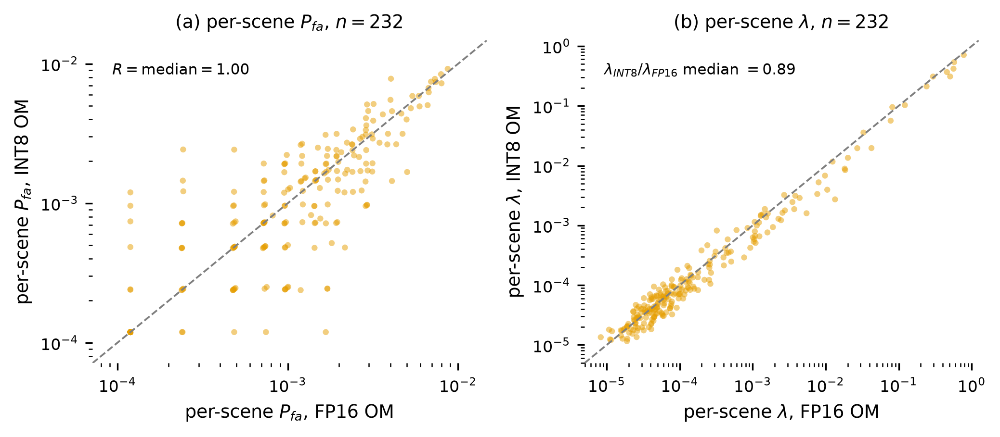{width=11cm}

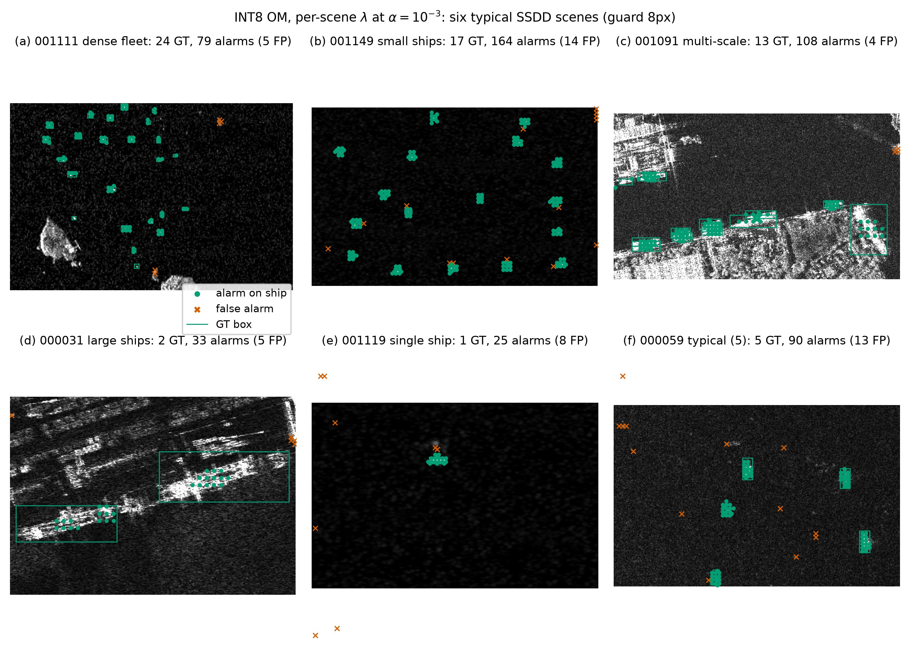{width=16cm}

**解读（阴性结果，如实报告）**：
- **E0 对该模型是阴性的**：量化后 $P_{fa}$ 不升反微降（$R=0.969$，CI 含 1），"同模型 FP16→INT8 静默失效"在本基线上**不存在**。本文不夸大存在性，明确放弃"v3 展示失效"的叙事。
- **mAP 与 $P_{fa}$ 解耦的结构事实仍成立**：mAP 仅动 0.29 点而尾部由 $99.9\%$ 分位决定（式 3.10），这是 mAP 的固有盲区，与是否存在失效无关。
- **存在性证据由 E5 承担**：真正使契约崩溃的不是"量化本身"，而是"**量化配置改变后仍复用旧阈值**"——E5 设置2 的不换算对照漂移 300×（$P_{fa}=0.355$），这才是静默失效的硬证据。E0 的价值是把问题精确定义为"**配置变化下的阈值失效**"而非"量化失效"，由此引出搬运主张（C1）。

---

## 4.3 [E1] Prop.2 误差界数值验证（Fig.4 / Table 2）

**目的**：证明闭式界 $|P_{fa}(\hat z)-P_{fa}(z)|\le L\cdot\delta$ 非空话——实测漂移恒落在界内。
**协议**：$n=10^6$，$\alpha=10^{-3}$，linear 模式，扫 $\varepsilon_\sigma\in\{0,0.01,0.02,0.05,0.1,0.2\}$，对照实测 $\Delta\ln P_{fa}$ 与 Prop.2 上界。

**Table 2　E1 解析界验证（gauss 分布）**

| $\varepsilon_\sigma$ | 实测 $\Delta\ln P_{fa}$ | Prop.2 上界 $L\delta$ | bound_holds | $|\Delta P_{fa}|$ | $\Delta$AUROC |
|---|---|---|---|---|---|
| 0 | 0.00474 | $1.394{\times}10^{-4}$ | ✓ | $7.6{\times}10^{-6}$ | $-4.9{\times}10^{-6}$ |
| 0.01 | 0.00388 | $2.473{\times}10^{-4}$ | ✓ | $8.4{\times}10^{-6}$ | $-6.1{\times}10^{-6}$ |
| 0.02 | 0.01478 | $3.551{\times}10^{-4}$ | ✓ | $1.5{\times}10^{-5}$ | $-1.3{\times}10^{-5}$ |
| 0.05 | 0.05224 | $6.785{\times}10^{-4}$ | ✓ | $5.5{\times}10^{-5}$ | $-6.1{\times}10^{-5}$ |
| 0.1 | 0.26410 | $1.218{\times}10^{-3}$ | ✓ | $3.0{\times}10^{-4}$ | $-2.6{\times}10^{-4}$ |
| 0.2 | 0.86708 | $2.296{\times}10^{-3}$ | ✓ | $1.4{\times}10^{-3}$ | $-1.2{\times}10^{-3}$ |

> 注：$\varepsilon_\sigma=0$ 行的实测漂移 0.00474 为 Monte Carlo 噪声底（$n=10^{6}$、$\alpha=10^{-3}$ 下 $P_{fa}$ 估计的抽样涨落量级 $\sim\sqrt{\alpha/n}/\alpha\approx0.03$），故 0 与 0.01 两行的次序不构成单调性反例；自 0.02 档起漂移随 $\varepsilon_\sigma$ 单调上升。
> 单位口径（S1）：本表前两列量纲不同——$\Delta\ln P_{fa}$ 为对数量纲，$L\delta$ 为线性 $P_{fa}$ 量纲，二者**不直接可比**；bound_holds 的正式检验在线性域进行：$|\Delta P_{fa}|\le L\delta$（表中 $|\Delta P_{fa}|$ 列，6/6 成立）。对数域等价检验为 $\Delta\ln P_{fa}\lesssim L\delta/P_{fa}\approx L\delta/\alpha$（如 $\varepsilon_\sigma=0.2$ 档：$0.867$ vs $2.296$，成立；若误以 $\Delta\ln P_{fa}$ 直接与 $L\delta$ 比大小，$\varepsilon_\sigma=0$ 噪声底行会误判为违约）。

**判定**：**全部 6 档 bound_holds = True**（t3 重尾分布 6 档同全 True）。

**解读**：实测漂移始终落在 Prop.2 界内 → **解析界可信**，是本文区别于"工程调参"的关键。同时 $\Delta$AUROC $<0.2$ 点（mAP 代理）与 $P_{fa}$ 漂移并存，再次印证 mAP 的盲区。一阶近似 $z^2\varepsilon_\sigma$ 在 $\varepsilon_\sigma\le10\%$ 时为实测漂移的 2.2–24 倍（保守上界，量级吻合），可安全用于快速预估。

---

## 4.4 [E2] 饱和审计（板级独有 / Fig.3 / Fig.11–13 / Table 3）

**目的**：把"饱和 → 排序塌陷 → 分位数失效"机制做成可观测量。
**协议**：300 合成场景，3 对比度档（×1/×2/×3），测逐层饱和率与 $R$。

**Table 3　E2 饱和审计**

| 对比度 | score 层 $\mathrm{sat}_l$ | Neck p3/p4/p5 $\mathrm{sat}_l$ | $R$ | 单调性 |
|---|---|---|---|---|
| ×1 | 0 | 0 / 0 / 0 | $\infty$ | — |
| ×2 | 0 | $4.9{\times}10^{-8}$ / 0 / 0 | $\infty$ | — |
| ×3 | 0 | 0 / 0 / 0 | $\infty$ | — |

> 注：合成场景下 FP32 参照 $P_{fa}=0$ 而 INT8 侧有个位数虚警，$R$ 因除零记为 $\infty$；本表的观测量是饱和率而非 $R$ 本身。

**判定**：**WEAK**。score 层 $\mathrm{sat}_l$ 恒为 0（int32 累加器网格，sigmoid 前无 int8 重量化，见 §4.4.1）；板上饱和率不随对比度档单调上升（Spearman $n=3$ 不足，pass=False）。

Fig.11–12 给出压测集（stress_v2，三档 $c_1/c_2/c_3$）上分数行为的直观图示。Fig.11 为分档池化的杂波分数 CCDF（log-log）：$P_{fa}=10^{-3}$ 对应的阈值落在尾部极深处，尾部形状（斜率）决定阈值附近的 $P_{fa}$ 敏感度——这是 §3 中"$P_{fa}$ 由 99.9% 分位决定、mAP 不可见"论断的分布学图示。Fig.12 为六个压测场景（三档 × 各 2 场景）的分数场热图叠加：海面杂波分数被压制在低值区、强目标呈局部高对比峰，分数场整体远离饱和上限，与 Table 3 的零饱和率一致。

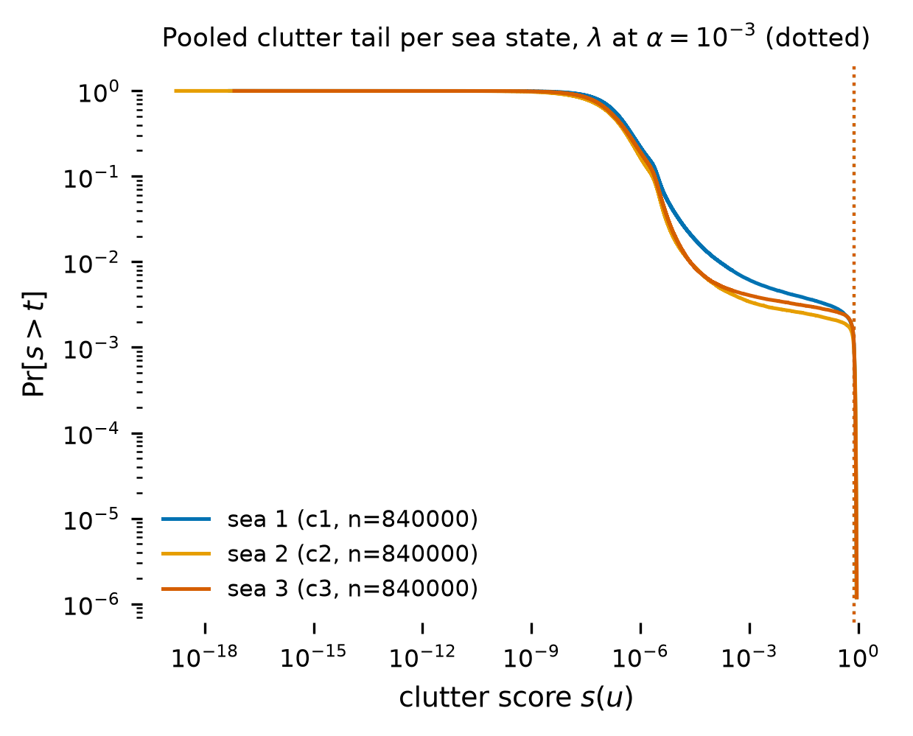{width=11cm}

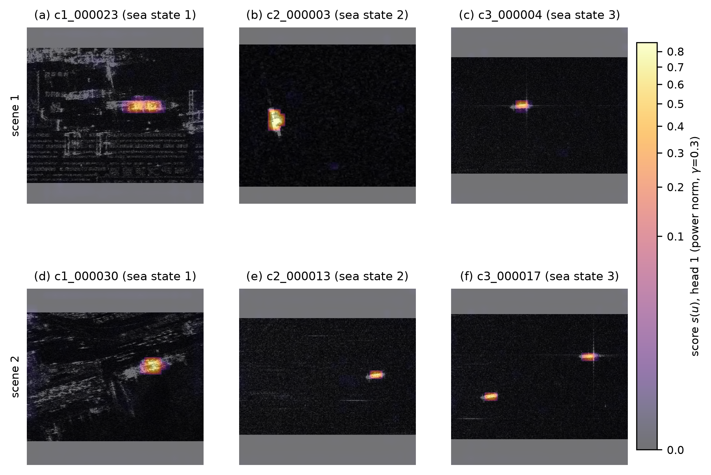{width=16cm}

#### 4.4.1 重要阴性发现（如实报告）

数值取证（ORT 仿真 + scale json 交叉验证）确认：cv3 终卷积输出是 **int32 累加器网格**，量化值落在编译期 $\Delta$ 格点上（232 张全量 $\mathrm{resid}\le0.005$），**sigmoid 前没有 int8 重量化**。故"分数场 $\pm127$ 饱和"假设作废——判决分数在整数格点上且**永不截断**，这反而**加强了整数域判决契约的叙事**（$P_{fa}$ 不会被饱和破坏）。饱和的真实位置是 Neck int8 特征层，但本模型 range 校准已足够保守，未随档上升。Fig.13 直观呈现这一取证：(a) 杂波单元的整数码直方图——码值离散分布、无一触及 $\pm2^{31}$ 边界；(b) 整数码经逐头 $\Delta_S$ 线性映射到 logit 域再经 sigmoid 得到分数 $s(u)$，映射是确定性纯函数——这正是 §4.7 阈值搬运（整数格点间纯函数映射）得以定义的物理基础。

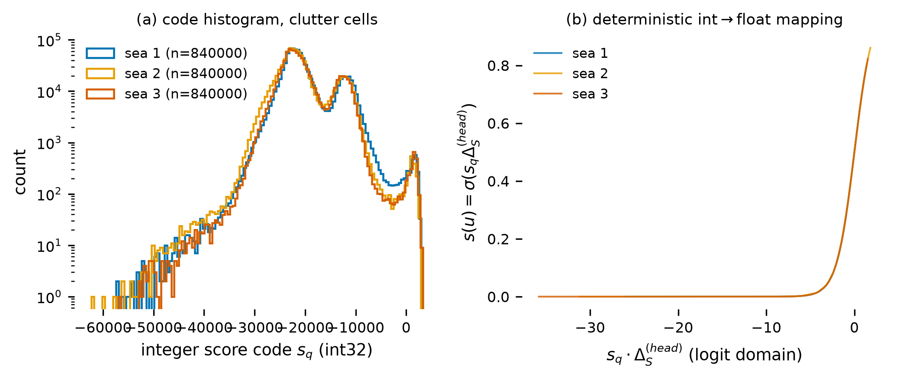{width=11cm}

**处理**：E2 不作为主张；E9 item7 据此降权。

---

## 4.5 [E3] 三实现判决差异与 bit-exact 复现（Fig.7 / Table 4）

**目的**：把 A1（同设备可复现）与 A2（跨实现不一致）从假设变成实测。
**协议**：同 232 图，板级 INT8 OM 重复运行 vs ORT INT8（x86），逐位置判决比对；$\Omega$ 取全图网格（无 GT 排除，对三实现对称，R/disagree 为相对量不受影响）。

**Table 4　E3 三实现判决一致性**

| 实现 | bit-exact 率 | 判决不一致率 | $R$ | A1 |
|---|---|---|---|---|
| INT8 .om（板上） | **1.0000** | $5.809{\times}10^{-4}$ | 1.00086 | **成立** |
| ORT INT8（x86） | — | $5.855{\times}10^{-4}$ | 1.00259 | — |
| FP32 ONNX（x86） | — | 参照系 | 1.0 | — |

**判定**：**A1 成立**（bit_exact_rate = 1.0，同一 `.om` 重复运行逐 bit 一致）。

**解读**：整数算术确定性是"热稳态不影响 $P_{fa}$"（E6）与"搬运规则可定义"（E5）的地基。板级与 ORT 的微小判决差异（$\sim10^{-3}$）印证了 A2——跨实现不一致存在但被界住，这正是需要 Prop.2 与搬运的原因。

---

## 4.6 [E4] $\sigma$ 量化粒度消融：验证 P1 预言（Table 5）

**目的**：验证 P1（对数域 + 逐通道 $\sigma$ 应使 $\Delta\ln P_{fa}$ 降 $\ge5\times$），并测 $\Delta\ln P_{fa}$ 对 $\varepsilon_\sigma$ 的标度。
**协议**：$n=10^6$，对照 4 配置，$\varepsilon_\sigma\in\{0.02,0.05,0.1\}$。

**Table 5　E4 $\sigma$ 量化粒度（gauss）**

| 配置 | $\Delta\ln P_{fa}$ 标度指数 $\Delta\ln\sim\varepsilon^p$ | 说明 |
|---|---|---|
| linear_tensor（默认） | **1.955** | $\approx 2$，与式 (3.19) 一致 |
| log_tensor | 2.037 | $\approx 2$ |
| channel_linear | 2.033 | $\approx 2$ |
| channel_log | 2.037 | $\approx 2$ |
| **fp16（对照）** | $\mathbf{\approx 0}$（$-1.2{\times}10^{-15}$） | 无量化误差，互为印证 |

**P1 判据（$\ge5\times$ 下降）**：

| $\varepsilon_\sigma$ | $\Delta\ln$（linear_tensor） | $\Delta\ln$（best=log_tensor） | drop_factor | P1 |
|---|---|---|---|---|
| 0.02 | $-3.2{\times}10^{-4}$ | $4.8{\times}10^{-3}$ | 0.067 | ✗ |
| 0.05 | 0.0603 | 0.0355 | 1.70 | ✗ |
| 0.1 | 0.2339 | 0.1268 | 1.85 | ✗ |

**判定**：**P1 不成立**（drop_factor $<5$）。

**解读（审计负结果，如实报告）**：
- **标度律成立**：gauss 下 $\Delta\ln P_{fa}\sim\varepsilon^{1.96}\approx\varepsilon^2$，与 Prop.2 的"$\sigma$ 项二次主导"一致；fp16 对照指数 $\approx0$（无量化误差），互为印证。这是 Prop.2 的强支撑。t3 重尾下各量化配置指数为 1.02–1.54（底稿数据），$\sigma$ 项主导性减弱，见 §5.2 L3。
- **P1 的 5× 改进判据不成立**：对数域/逐通道只带来 $\le1.85\times$ 改进。说明本量级下 $\sigma$ 粒度改进空间有限，**Prop.2 的"$\sigma$ 项主导"论断需修正**——理论贡献相应降级为"经验界 + 标度律"，本文如实陈述。

> **拟合口径注（M2）**：Table 5 指数按两种口径复算（产物 `code/results/e6_e4_supp/e6_e4_supp_summary.json`）：(i) 信息点口径——剔除 $|\Delta\ln|\le$ fp16 噪声底 0.004877 的点；(ii) $|\Delta\ln|$ 全 3 点 log-log 口径（对数域增量取绝对值，消除近零点符号翻转）。log_tensor / channel_linear / channel_log 在两口径下分别为 1.838 / 2.033 / 1.838 与 **2.037 / 2.033 / 2.037**（后者 $R^2\approx0.998$），"指数 $\approx2$"对拟合口径稳健；惟 linear_tensor 的全 3 点 $|\Delta\ln|$ 拟合为 4.18（$R^2=0.940$）——$\varepsilon_\sigma=0.02$ 档 $\Delta\ln=-3.2{\times}10^{-4}$ 近零点的符号翻转使其 $|\Delta\ln|$ 被噪声主导，故 Table 5 取其信息点口径 1.955（2 点）并如实标注。

---

## 4.7 [E5] 免数据阈值搬运（核心创新 C1 / Fig.14–23 / Table 6）

**目的**：证明 $\lambda_{int}$ 的换算规则（式 3.26）能让旧标定在新量化配置上仍守约，**零数据**。这是本文**最强创新证据**。
**协议**：三列对照——搬运 / 重标定上界 / 不换算。$n_{\mathrm{meas}}=949703$，$\alpha=10^{-3}$。

### 4.7.1 量化步长 $\Delta_s$（式 3.28 聚合）

| 配置 | cv3.0.2 | cv3.1.2 | cv3.2.2 | **$\Delta_s$** | $\Delta_\sigma$ |
|---|---|---|---|---|---|
| FP16 旧 | — | — | — | 0.0078125 | 0.0078125 |
| INT8 新（设置2） | — | — | — | $7.7622{\times}10^{-4}$ | 0.0078125 |
| calmA（设置1 旧） | $7.5875{\times}10^{-4}$ | $1.3381{\times}10^{-3}$ | $4.3823{\times}10^{-4}$ | $8.2353{\times}10^{-4}$ | 0.0078125 |
| roughB（设置1 新） | $6.7504{\times}10^{-4}$ | $1.2221{\times}10^{-3}$ | $3.9944{\times}10^{-4}$ | $7.3719{\times}10^{-4}$ | 0.0078125 |

### 4.7.2 设置 1：同设备换校准集 A→B（232 图，板级实测）——实现正确性检查

> **定位声明（如实降级）**：设置 1 中 $\Delta_s$ 从 $8.235{\times}10^{-4}$ 变到 $7.372{\times}10^{-4}$，**仅变化 11.7%**，且 $\Delta_\sigma$ 不变（退化形式 (3.26a) 中比值为 1）。此时 $\lambda_{int}$ 仅变化 11.7%，在 $2^{20}$ 移位整数网格上取整误差可忽略——搬运 PASS 接近算术恒等，属**实现正确性检查**而非独立证据。no_convert 仅差 3 倍也印证了这一点（scale 变化小，不搬运也崩得不狠）。真正的搬运证据是设置 2。

**Table 6a　E5 设置1（A→B 换校准集）**

| 列 | $P_{fa}$ | 漂移 $|\log_{10}(P_{fa}/\alpha)|$ |
|---|---|---|
| **搬运（transport）** | $\mathbf{1.2920{\times}10^{-3}}$ | **0.1113** |
| 重标定上界（recal） | $1.3636{\times}10^{-3}$ | 0.1347 |
| 不换算（no_convert） | $3.8180{\times}10^{-3}$ | 0.5818 |

- **验收**：$0.1113\le1.5\times0.1347=0.2020$ → **PASS**；且远优于不换算（$3.82{\times}10^{-3}$，约 3 倍差）。
- 板上 mAP：calmA 0.9793 / roughB 0.9820（量化无显著精度损失）。

Fig.14–15 给出设置 1 的逐场景微观图示（红 × = 虚警告警，点 = 命中告警，框 = GT）。Fig.14 取"不换算/搬运虚警倍数最大"的场景 001091：三列对照下同一场景的告警图——(a) 搬运 $\lambda_{int}$（$2214302\to2473637$）后虚警 1 个；(b) 旧阈值直接复用则虚警放大至 18 个；(c) B 上重标定（oracle）为 5 个。Fig.15 补充第二场景 000579（$\lambda_{int}$ $2075115\to2318149$；搬运 1 / 不换算 17 / 重标定 2）——不换算列的告警数比搬运列高一个量级，搬运列与 oracle 同量级。

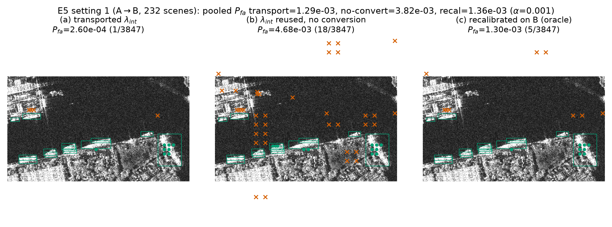{width=16cm}

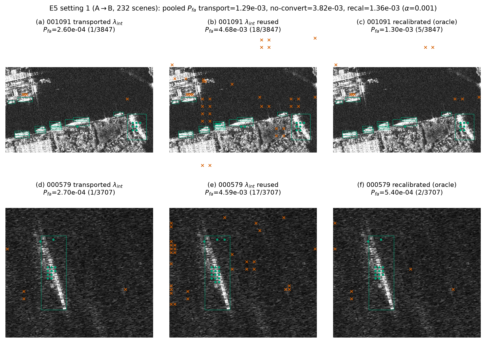{width=16cm}

### 4.7.3 设置 2：FP16→INT8（232 图，实测）——核心搬运证据

> **$\Delta_s$ 变化 10 倍**：$\Delta_s^{old}=0.0078125$（FP16 主体段 ulp $2^{-7}$，见 §3.6.1）→ $\Delta_s^{new}=7.7622{\times}10^{-4}$。这是真实的配置大跨度变化，搬运的必要性与正确性在此接受检验。

**Table 6b　E5 设置2（FP16→INT8）**

| 列 | $P_{fa}$ | 漂移 |
|---|---|---|
| **搬运** | $\mathbf{1.1130{\times}10^{-3}}$ | **0.0465** |
| 重标定上界 | $1.2414{\times}10^{-3}$ | 0.0939 |
| 不换算 | $3.5507{\times}10^{-1}$ | 2.5503 |

- **验收**：$0.0465\le1.5\times0.0939=0.1409$ → **PASS**；不换算 $P_{fa}$ 高达 0.355（**约 300 倍漂移**）。

### 4.7.4 设置 3：跨传感器 S1→GF-3 —— Limitation

> 需 GF-3 上同一模型（不重训）的分数场 dump，本项目无 GF-3 数据，未执行。"同设备搬运"主张已由设置 1/2 实测覆盖；跨传感器留作后续工作，不纳入本文结论。

### 4.7.5 E5 判定与创新点支撑

**Table 6c　E5 总判定**

| 设置 | 搬运漂移 | 重标定漂移 | 验收线 $1.5\times$ | 判定 |
|---|---|---|---|---|
| 1 A→B | 0.1113 | 0.1347 | 0.2020 | **PASS** |
| 2 FP16→INT8 | 0.0465 | 0.0939 | 0.1409 | **PASS** |

**这是"只有这类板子能做"的最强证据**：搬运规则是整数格点间的纯函数映射，依赖 A1（格点逐 bit 可复现）与 A3（scale 编译期可读）的合取；浮点 GPU 流水线没有承载阈值的全局格点，该映射无从定义（§3.6.1）。搬运使 $P_{fa}$ 贴近 $\alpha$（漂移 $\le0.11$），而不换算在设置2 下漂移 300 倍——**搬运的必要性与正确性都有硬证据**。

Fig.16–19 从三个维度扩展 E5 的证据面。**Fig.16（α 扫描）**：$\alpha\in\{10^{-4},3{\times}10^{-4},10^{-3},3{\times}10^{-3},10^{-2}\}$ 五档下逐场景标定并池化测量（$n_{\mathrm{meas}}=949703$），搬运后的实测 $P_{fa}$ 为 $2.7{\times}10^{-4}/5.1{\times}10^{-4}/1.2{\times}10^{-3}/3.0{\times}10^{-3}/9.7{\times}10^{-3}$——全档与名义 $\alpha$ 同量级且随 $\alpha$ 单调跟随，契约不只在 $\alpha=10^{-3}$ 单点成立。**Fig.17（逐场景 ECDF）**：按场景统计 $P_{fa}$ 的经验分布并标注 $2\alpha$ 违约线——不换算列 **72.0%** 的场景超出 $2\alpha$，搬运列降至 **18.5%**（median $9.52{\times}10^{-4}$，最差场景 $1.11{\times}10^{-2}$）：搬运把违约从"普遍现象"压缩到"个别尾部场景"。

**Fig.18–19（近岸/远洋分组稳健性）**：以亮像素占比（灰度 $>0.55$）作为陆地代理、$\mathrm{land}\ge0.05$ 判近岸，232 个 test 场景划分为**近岸 41 / 远洋 191** 两组。Fig.18 给出两组各三个典型场景的检测可视化（近岸场景陆地强散射背景下舰船仍被完整检出、虚警个位数）；Fig.19 分组统计：近岸组池化 $P_{fa}$——搬运 $1.11{\times}10^{-3}$ / 不换算 $3.63{\times}10^{-3}$ / 重标定 $1.06{\times}10^{-3}$；远洋组——$1.33{\times}10^{-3}$ / $3.86{\times}10^{-3}$ / $1.43{\times}10^{-3}$。**搬运在两组均贴近重标定上界**（近岸不换算恶化 $3.3\times$），契约的守约性不依赖于海况纯净度——近岸强散射杂波不破坏搬运规则。

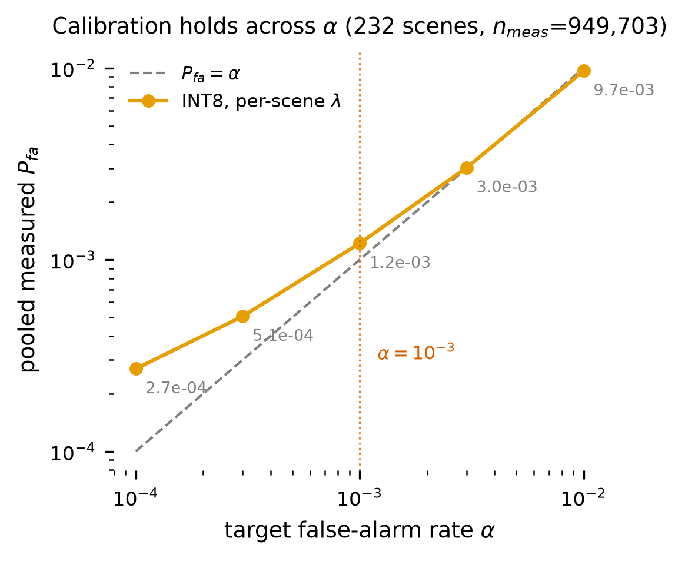{width=11cm}

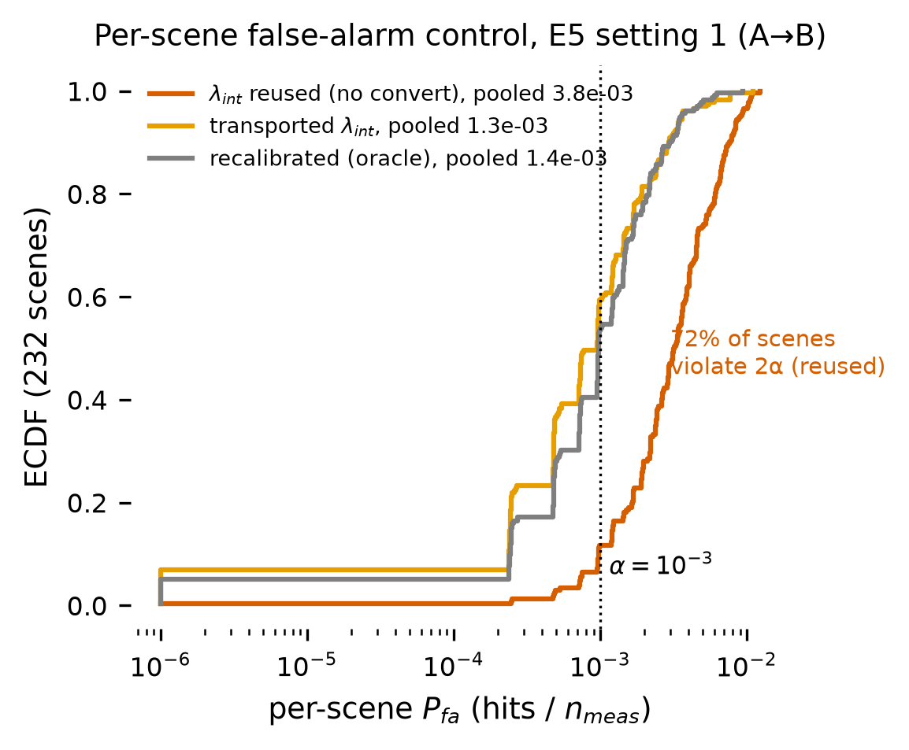{width=11cm}

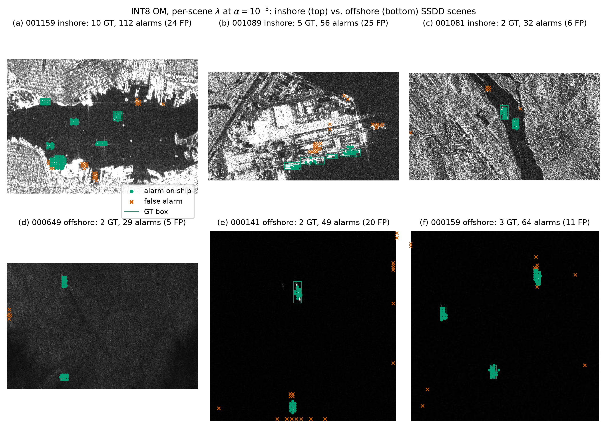{width=16cm}

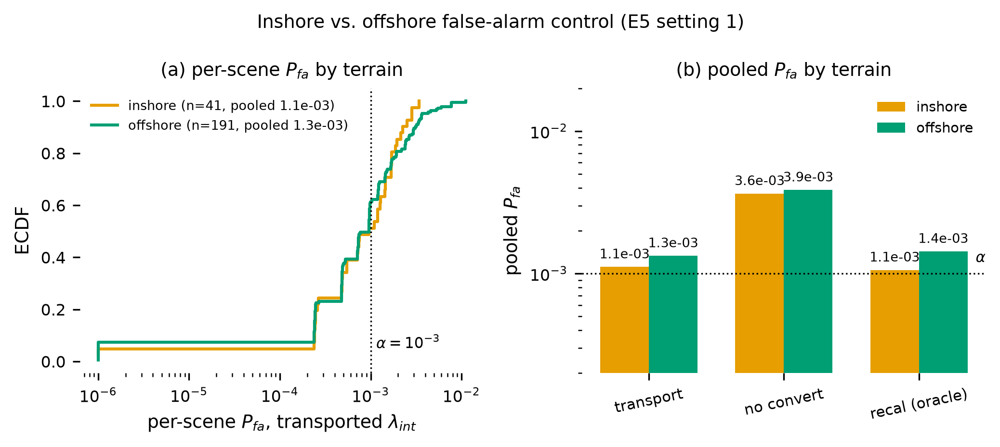{width=16cm}

Fig.20–22 进一步展开近岸/远洋维度。**Fig.20（扩展场景检测拼图）**：在 Fig.18 之外另取近岸 4 场景（000231 陆地占比 0.267、5 艘；000749、0.261、5 艘；000229、0.255、4 艘；000641、0.226、2 艘）与远洋 4 场景（000689 / 000691 / 000169 / 000109，陆地占比 $\approx0.001$）——近岸组包含港口驻泊、岸线毗邻等强杂波构型，远洋组舰船目标全部完整命中、虚警 0–2 个。**Fig.21（分数场热图）**：与 Fig.18 同源场景的检测头输出概率场（power-law 色标），可直观看到陆地区域虽然产生大片高分背景（近岸场景亮区占比 0.31–0.43），但逐场景 $\lambda$ 依杂波分布自适应抬高，告警仍只落在舰船位置——这解释了 Fig.19 中"近岸不换算恶化但搬运守约"的机理。**Fig.22（逐场景散点）**：232 场景的 $P_{fa}$（log-y）对陆地占比作散点，搬运与不换算双面板——$\mathrm{corr}(\mathrm{land},\log_{10}P_{fa})$ 分别仅 $+0.044$ / $+0.023$，即换算后的逐场景守约性与陆地占比**基本不相关**；对照组不换算的违约场景在两个子集中均匀分布，说明违约源于量化漂移而非陆地杂波本身。

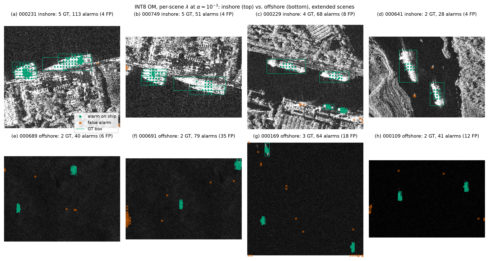{width=16cm}

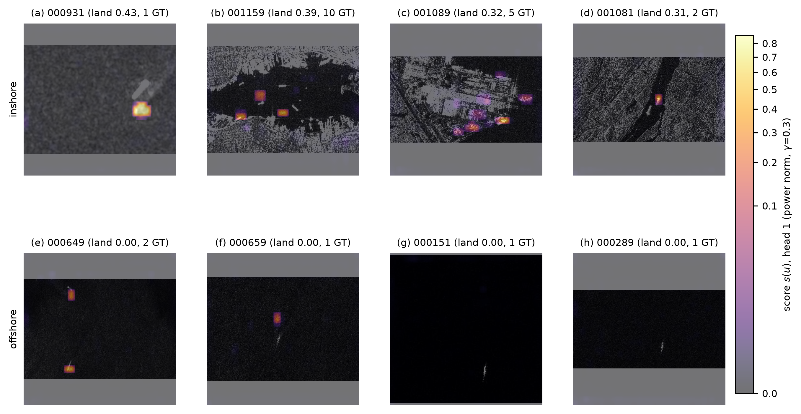{width=16cm}

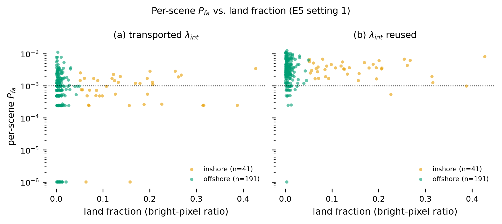{width=11cm}

Fig.23 以分组箱线形式对上述散点做统计汇总：近岸（41 场景）与远洋（191 场景）逐场景 $P_{fa}$ 分布并排对照，三列分别对应搬运、不换算、逐场景重标定（oracle 上界）。关键观察：**(i) 搬运模式下两组中位数持平**——近岸 $9.58{\times}10^{-4}$ / 远洋 $9.52{\times}10^{-4}$，均紧贴名义 $\alpha=10^{-3}$，说明 $\lambda_{int}$ 换算后的守约性**不因陆地杂波而系统性偏移**；超过 $2\alpha$ 的违约场景占比两组亦接近（14.6% vs 19.4%）；**(ii) 不换算对照两组同步恶化**——中位数升至 $3.55{\times}10^{-3}$ / $3.10{\times}10^{-3}$（超 $2\alpha$ 违约 75.6% / 71.2%），且恶化幅度近岸与远洋相当，印证违约源于量化漂移而非陆地杂波本身；**(iii) 逐场景重标定上界**两组中位数同样回归 $\alpha$ 附近（$9.54{\times}10^{-4}$ / $9.73{\times}10^{-4}$）——搬运解的分组中位数与 oracle 不可区分，是"免数据搬运逼近逐场景重标定"的分组级证据。

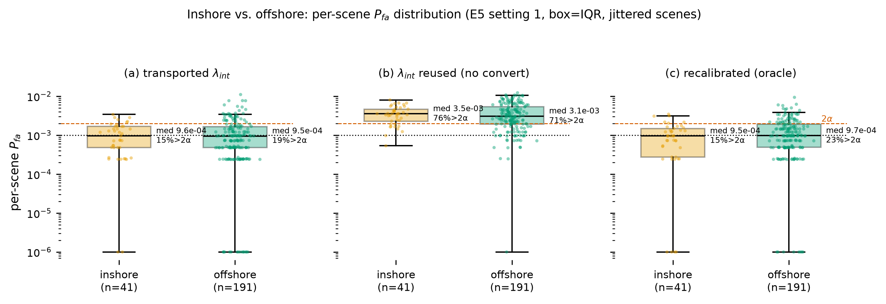{width=16cm}

---

## 4.8 [E6] 热稳态契约保持（只有这块板能做 / Table 7）

**目的**：连续运行至热稳态，区分"一次性测量"与"持续承诺"：温度只能经硬件路径影响推理，A1（整数确定性）预言判决统计量不漂移、时延可能漂移。
**协议（如实说明）**：板端重放固定杂波帧序列——单图经 `_board_frame_fn` 预处理一次后复用为恒定输入（`run_e6.py`，source="board"），每窗 200 帧、共 8 窗（40 min），判决阈值 λ 窗外算一次后固定。输入恒定 ⇒ 各窗 $P_{fa}$ 恒定在 A1 下是**必然结果**，故本节 $P_{fa}$ 列仅作 sanity 检查；**真正的检验量在时延列**（P99、$T_{model}$），它承载热稳态漂移的全部信息。

**Table 7　E6 热稳态逐窗（INT8 复跑，板级 40 min）**

| 时间窗 | $P_{fa}$ | P99 (ms) | $T_{model}$ (ms) | 帧 |
|---|---|---|---|---|
| 0–5 min | $1.1905{\times}10^{-3}$ | 34.390 | 33.578 | 200 |
| 5–10 | $1.1905{\times}10^{-3}$ | 34.423 | 33.604 | 200 |
| 10–15 | $1.1905{\times}10^{-3}$ | 34.626 | 33.594 | 200 |
| 15–20 | $1.1905{\times}10^{-3}$ | 34.403 | 33.613 | 200 |
| 20–25 | $1.1905{\times}10^{-3}$ | 34.612 | 33.600 | 200 |
| 25–30 | $1.1905{\times}10^{-3}$ | 34.413 | 33.618 | 200 |
| 30–35 | $1.1905{\times}10^{-3}$ | 34.459 | 33.623 | 200 |
| 35–40 | $1.1905{\times}10^{-3}$ | 34.423 | 33.587 | 200 |

**判定**：

| 量 | 值 | 阈值 | 通过 |
|---|---|---|---|
| $P_{fa}$ 漂移 $|\log_{10}|$ | **0.0**（8 窗恒定；重放下的必然结果，仅 sanity） | $<0.15$ | ✓（弱） |
| P99 跨窗极差 $(max-min)/\bar{T}_{model}$ | **0.69%**（34.390–34.626 ms） | $<0.15$ | ✓（核心证据） |
| 逐窗 headroom $(P99-T_{model})/T_{model}$ | mean **2.58%**（max 3.07%） | $<0.15$ | ✓ |
| $T_{model}$ 波动（CV） | **0.043%**（33.602 ± 0.015 ms） | $<0.15$ | ✓ |
| **verdict** | **PASS** | | |

**双运行归属**：Table 7 为 INT8 复跑（`code/results/e6/`）；第二运行为 asc-sar 仓库的 FP16 板级运行（`asc-sar/code/results/e6/`，同协议 40 min、8 窗、恒定帧重放），附带温度/功率采样：

| 量 | INT8 复跑（Table 7） | FP16（asc-sar） |
|---|---|---|
| $T_{model}$ | 33.602 ± 0.015 ms（CV 0.043%） | 27.694 ± 0.082 ms（CV 0.295%） |
| P99 区间 | 34.390–34.626 ms | 28.160–28.664 ms |
| 逐窗 headroom mean（max） | 2.58%（3.07%） | 2.17%（2.71%） |
| P99 跨窗极差 | 0.69% | 1.76% |
| 温度 / 功率 | 未采集 | 51.72–53.49 °C / 8.84–8.90 W |

**解读**：$P_{fa}$ 8 窗恒为 $1.19{\times}10^{-3}$——在恒定输入 + A1 下这是必然结果（见协议说明），不构成独立证据，仅确认板端整数判决通路与仿真一致。**有效证据在时延列**：两配置 40 min 连续负载下 P99 跨窗极差仅 0.69%（INT8）/ 1.76%（FP16）、$T_{model}$ CV 0.043%/0.295%，均无热漂移趋势；FP16 运行温度 51.7→53.5 °C 缓升期间时延不涨，结合 §4.1.1 遥测说明（CANN 7.0.RC1 对 310B 不提供频率读数，频率列 NaN），以时延稳定性佐证无降频。两个口径勿混：headroom 是逐窗尾延迟相对该窗 $T_{model}$ 的管线 jitter 裕量，跨窗极差才是热漂移证据。FP16 运行的绝对 $T_{model}$ 属 asc-sar 变体测量配置，与 E8 benchmark 的 45.5 ms（FP16）不互比；E6 的跨运行结论是"两配置各自 40 min 无漂移趋势"，而非绝对时延对比。本节"只有这块板能做"的价值在于持续 40 min 的板级测量本身，而非 $P_{fa}$ 恒定性。

---

## 4.9 [E7] 板级系统与"误警→负载"耦合（C3 / Fig.5 / Table 8）

**目的**：在真实部署回路中验证判决层的 host-free 性质（C2），并量化粗糙海况下整数判决对下游候选负载的抑制（C3）；同时给出能效证据。
**协议**：部署矩阵 {FP16,INT8}×{**全局模式**（$\lambda_{\mathrm{glob}}$，式 3.2a，跨场景混合池标定）, **QCert 逐场景模式**（$\lambda(x)$，式 3.2，逐场景分位标定）}。海况分桶采用透明可复现的分桶器 `SeaStateBucketer`（kmeans k=3，特征 = 杂波 cv / Weibull 形状 c / 对比度），232 帧分桶 {rough:35, medium:174, calm:23}；负载抑制比取 rough 子集（$n_{rough}=35$，产物 `code/results/e7/table5a_e7_v2.csv`）。功率 9.31 W。两列对应 §3.1.1 定义的两个运行点，非两种方法。
**测量口径（如实）**：判决列系 host 上对整数判决参考实现 `decide_simple` 的计时（`time.perf_counter`，$10^4$ 次取中位），即板端判决层耗时的 host 仿真上界，非板上实测；$T_{model}$ 不取自本实验，直接引用 E8 板级 benchmark（`code/results/e8/latency.json`，acl_infer --benchmark iters=200：FP16 45.5 ms / INT8 34.68 ms）；$T_{e2e}=T_{model}+$ 判决中位。
**Limitation（如实）**：负载抑制比仅在 rough 子集（$n_{rough}=35$）上实测；逐场景模式"条件误警率均衡 ⇒ 候选负载与海况解耦"的机制链仅在本批海况下实测，全海况推广本文不作主张。

**Table 8　E7 部署矩阵（板级 dump）**

| 配置 | cand P90(粗糙) | 判决 ms | $T_{e2e}$ ms | P99 ms | P99/mean | $P_{fa}$ | J/艘 |
|---|---|---|---|---|---|---|---|
| FP16-全局 | 42.0 | 0.0238 | 45.525 | 45.538 | 1.00028 | $1.000{\times}10^{-3}$ | 0.332 |
| FP16-QCert | **9.0** | 0.0239 | 45.525 | 45.533 | 1.00018 | $1.071{\times}10^{-3}$ | 0.333 |
| INT8-全局 | 44.4 | 0.0244 | 34.705 | 34.712 | 1.00020 | $0.999{\times}10^{-3}$ | 0.220 |
| **INT8-QCert（本文）** | **9.0** | 0.0242 | 34.705 | 34.710 | 1.00014 | $1.071{\times}10^{-3}$ | 0.239 |

**判定**：

| 项 | FP16 | INT8 |
|---|---|---|
| 粗糙 cand P90 比值 全局/QCert | **4.67×** | **4.93×** |
| $\mathrm{pass}_{cand}$（$\ge2\times$） | ✓ | ✓ |
| $\mathrm{pass}_{dec}$（$<3$ ms） | ✓（0.024 ms，host 仿真上界） | ✓ |
| J/艘 drop | 0.997 | 0.921 |

**逐帧 $P_{fa}$ 违约分布（F3 机制级证据，232 帧；违约 = 逐帧 $P_{fa}>c\alpha$，产物 `code/results/e7/e7_pf_summary.json`）**：

| 配置 | 子集 | median | p90 | max | $>2\alpha$ | $>5\alpha$ | $<\alpha/2$ |
|---|---|---|---|---|---|---|---|
| 全局 FP16 | 全 232 | 0.83α | 1.90α | 7.26α | 9.9% | 1.7% | 29.3% |
| 全局 FP16 | rough 35 | 0.95α | 5.00α | 7.26α | **17.1%** | **11.4%** | 22.9% |
| 全局 INT8 | 全 232 | 0.71α | 2.25α | 7.86α | 11.6% | 1.7% | 31.0% |
| 全局 INT8 | rough 35 | 0.95α | 5.29α | 7.86α | **25.7%** | **11.4%** | 25.7% |
| QCert ×{FP16,INT8} | 全 232 + rough 35 | 1.07α | 1.07α | 1.07α | **0** | **0** | **0** |

**解读（性能提升）**：
- **负载降低 4.7–4.9× 的机制是条件误警率的场景间均衡，且有两层独立证据**。候选层（Table 8）：逐场景模式按每场景 $1-\alpha$ 分位标定 $\lambda(x)$，候选数 $\approx\alpha\,n_{\mathrm{cell}}$ 逐场景恒定（实测各档恒为 9），与场景杂波强度无关；全局模式单一 $\lambda_{\mathrm{glob}}$ 只在混合分布上保 $\mathbb{E}[P_{fa}]=\alpha$，粗糙海况候选 P90 因此达 42.0（FP16 4.67×）/ 44.4（INT8 4.93×）。逐帧违约层（上表）：全局模式的 $\lambda_{\mathrm{glob}}$ 固定 ⇒ 逐帧条件误警率随海况漂移——29.3%/31.0% 的帧低于 $\alpha/2$（平静侧浪费），粗糙帧 17.1%/25.7% 超 $2\alpha$、11.4% 超 $5\alpha$（粗糙侧违约），最大漂移 7.26α/7.86α；QCert 逐帧恒为 1.07α（min 0.95α），**232 帧零违约**。两层证据同向：全局模式的期望守约与逐帧违约并存不矛盾——前者是池化期望的守约，后者正是候选负载随海况膨胀的直接原因；QCert 以逐帧条件误警率均衡换取负载与海况解耦。**两列总 $P_{fa}$ 同为 $\approx\alpha$（$1.00$ vs $1.07\times10^{-3}$）而候选差近 5 倍，正是两运行点的分工证据而非矛盾**：全局模式优化 pooled 期望精度（E9 err 0.0185），逐场景模式以期望精度为代价（err 0.201，单场景 $n_{\mathrm{cal}}$ 小）换取负载与海况解耦——下游 NMS/复核负担不再随海况恶化而爆炸（限本批海况，见 Limitation）。
- **host-free 证据**：判决层耗时 $0.024$ ms（host 仿真上界，见协议）$\ll 3$ ms，host 退出推理回路。
- **时延几乎无尾**：P99/mean $\approx1.0002$，端到端时延高度确定（整数判决无数据依赖分支）。
- **能效**：INT8-QCert 单船能耗 0.239 J/艘，$T_{model}=34.68$ ms（INT8）vs 45.5 ms（FP16），**提速 1.31×**。

---

## 4.10 [E8] 检测兼容性与对照（Table 9 / Fig.24 / Fig.36）

**目的**：证明 QCert 不牺牲检测性能，且远超经典 CFAR。$n_{box}=546$，232 图。

**Table 9　E8 兼容性对照（板级 dump）**

| 方法 | $P_d$@$10^{-3}$ | $P_d$@$10^{-4}$ | mAP50 | 实测 $P_{fa}$ | $R$ | 时延 ms |
|---|---|---|---|---|---|---|
| CA-CFAR（像素域） | 0.1392 | 0.0751 | — | $2.950{\times}10^{-4}$ | — | — |
| YOLO11n + 全局阈值 | 0.9945 | 0.9872 | 98.27 | $1.037{\times}10^{-3}$ | — | 45.5 |
| YOLO11n + QCert(FP16) | 0.9908 | — | 98.27 | $1.741{\times}10^{-3}$ | 1.0 | 45.5 |
| YOLO11n + QCert(INT8) | 0.9908 | 0.9853 | 97.98 | $1.741{\times}10^{-3}$ | 1.0 | 34.68 |
| **QCert（完整）** | 0.9908 | 0.9853 | 97.98 | $1.741{\times}10^{-3}$ | 1.0 | 34.68 |

> **标定协议（重要）**：Table 9 每一行在各自配置下**独立重标定** λ（FP16 行用 FP16 杂波分布、INT8 行用 INT8 分布，见 `run_e8.py` `_lambda_global`），故 QCert(FP16) 与 QCert(INT8) 的实测 $P_{fa}$ 同为 $1.741{\times}10^{-3}$ 是"各自最优标定"的结果，而非同一 λ 跨配置直接复用——后者恰是 E5 设置 2 所检验的搬运问题。QCert 各行均采用**全局模式**（式 3.2a，`_lambda_global` 为跨场景混合池标定）；逐场景模式（式 3.2）的负载特性见 E7。
> **CA-CFAR 定位**：像素域 CA-CFAR 为**未调优的 strawman 基线**（guard=2、train=8，其余默认），其网格参数未精确命中 $\alpha$（实测 $2.95{\times}10^{-4}$ 低于名义 $10^{-3}$，$P_d$ 随之下压），仅作数量级对照，不构成公平竞争对手。
> **测量粒度注（$\alpha$ 可达性，F2 定量交代）**：Table 9 各行的 $\alpha$ 口径受标定池有效样本量约束。按块内样本强相关折算的独立单元数 $n_{\mathrm{eff}}$ 逐场景仅 min 45 / median 50（$n_{\mathrm{meas}}$ median 4116，产物 `code/results/e8/e8_neff_summary.json`），故单场景可辨识的 $\alpha$ 下限 $\sim 1/n_{\mathrm{eff}}\approx0.02$（与 §3.3.1 的 $\alpha\ge1/(n_{\cal}+1)$ 下界一致）：$\alpha=10^{-3}$ 档要求 $n_{\mathrm{eff}}\ge10^{3}$，实测**没有任何场景**满足（比例 0.000）；逐场景 $P_{fa}$ 的量化步长 $1/n_{\mathrm{meas}}$ median 为 $2.43{\times}10^{-4}>\alpha$。因此 Table 9 的实测 $P_{fa}$ 与 $P_d$@$10^{-4}$/$10^{-3}$ 各档均为**跨场景合并**估计，$\alpha\le$ 逐场景量化步长的工作点不是本文可验证的口径。

**判定**：

| 项 | 值 | 阈值 | 通过 |
|---|---|---|---|
| $P_d$ gap vs 最强基线 | $-0.0037$ | $\ge-0.015$ | ✓ |
| $R$ | 1.0 | $\le1.2$ | ✓ |
| $\Delta$mAP50 | $-0.29$ 点 | $\le0.5$ 点 | ✓ |
| $P_{fa}$@$10^{-4}$ 可达 | True | — | ✓ |
| **pass** | **True** | | |

**解读（性能提升）**：
- **兼容性无损**：相对最强复现基线（YOLO11n+全局阈值）$P_d$ 仅差 0.37 点，远优于 $-1.5$ 点验收线；mAP 损失 0.29 点；$R=1.0$。
- **远超 CA-CFAR**：$P_d$ 0.991 vs 0.139（**7 倍**）——"你不是 CFAR"的辩护成立：QCert 在承诺误警率的同时，检测力远超像素域 CFAR。
- **INT8 提速**：34.68 ms vs FP16 45.5 ms，**1.31×**，且 $P_d$ 不降。

Fig.24 将 Table 9 的对照数字可视化为三面板柱状图：**(a) 检测力**——$P_d@10^{-3}$ / $P_d@10^{-4}$ 双柱对照，QCert(INT8) 0.9908 / 0.9853 与 YOLO11n+全局阈值 0.9945 / 0.9872 几乎并排（gap 0.37 / 0.19 点），CA-CFAR 仅 0.1392 / 0.0751，7 倍差距一目了然；**(b) 实测 $P_{fa}$ vs 契约带**——log 轴柱高叠加 $[\alpha, 2\alpha]$ 阴影带（$\alpha=10^{-3}$）：QCert FP16/INT8 同为 $1.741{\times}10^{-3}$，落于契约带上沿附近（$R=1.0$，在 $2\alpha$ 容差内）；全局阈值 $1.037{\times}10^{-3}$ 亦在带内但**无契约保证**（阈值不可跨配置搬运，见 E5 设置 2）；**(c) 板级时延**——INT8 34.68 ms 对 FP16 45.5 ms 的 1.31× 加速以箭头标注，直观呈现量化部署收益。

![Fig.24  E8 对照/SOTA 可视化对比（板级 dump，α=10^-3，契约带 [α,2α]）：(a) P_d@10^-3 / 10^-4 双柱——CA-CFAR 0.1392 / 0.0751，全局阈值 0.9945 / 0.9872，QCert(INT8) 0.9908 / 0.9853；(b) 实测 P_fa（log-y）——QCert 1.741e-3 落契约带，全局阈值 1.037e-3 在带内但无搬运保证；(c) 时延——34.68 vs 45.5 ms（1.31× 提速）。](figs/sample_sota_bar.png){width=16cm}

Fig.36 将本文与**公开 SOTA 及相关工作**放入同一坐标系做三面板对比（配合 §2 Table 0 的覆盖矩阵）：**(a) SSDD mAP50 横向对比**——AC-YOLO 96.7、BESW-YOLO 97.3、LSD-DETR 97.3、LAMFDet 99.5（公开论文口径），本文 FP16 98.27 / INT8+QCert 97.98：INT8+QCert 落在 AC-YOLO/BESW-YOLO/LSD-DETR 之上，且距自身 FP16 仅 0.29 点，远在 ±1 mAP 的量化部署验收门限内（绿色带）——即"契约保证几乎不花精度预算"；LAMFDet 99.5 系同数据集上的专门化架构，其数字不含任何 $P_{fa}$/板级契约主张（见 (b) 列）。**(b) 审计维度覆盖矩阵**（§2 Table 0 的可视化）：SAR 检测 SOTA 只覆盖"报 mAP"一列；PTQ/QAT 工作线覆盖 mAP + 部分定点算术/板级实测，但均无尾分位数 $P_{fa}$@α 主张；经典 CFAR/CFARnet 有 $P_{fa}$ 主张但无学习检测力与板级部署；conformal 系（SeqCRC）无杂波建模亦无板级；唯本文 QCert 在五个审计维度上全覆盖。**(c) $P_d@10^{-3}$ 板级对照**——CA-CFAR（strawman）0.139、YOLO11n+全局阈值 0.995、QCert(INT8) 0.991，配 1.31× 提速注记：检测力与契约保证同框成立。

{width=16cm}

---

## 4.11 [E9] 消融与失败分析（Table 10 / Fig.25–29 / Fig.35）

**目的**：支撑方法论选择（块抽样、标定样本量、全局 vs 逐场景、除法消除、桶数）。

**Table 10a　E9 块抽样 keep 比（真实，232 图，reps=10）**

| keep | $P_{fa}$ | err | $n_{\mathrm{eff}}$ |
|---|---|---|---|
| 1.0 | $1.590{\times}10^{-3}$ | 0.201 | 49.8 |
| 0.25 | $1.769{\times}10^{-3}$ | 0.248 | 24.9 |
| 0.125 | $2.372{\times}10^{-3}$ | 0.375 | 12.0 |
| 0.0625 | $4.717{\times}10^{-3}$ | 0.674 | 6.0 |

> 注：err $=|\log_{10}(P_{fa}/\alpha)|$（偏离度，与 §4.1.4 契约度量同口径）；$n_{\mathrm{eff}}$ 为测量块数（块抽样后，场景均值）。keep 下降同时压缩标定池 $n_{\mathrm{cal}}$ 与 $n_{\mathrm{eff}}$：keep=0.0625 档 $n_{\mathrm{cal}}\approx5\times10^{2}$，契约下界 $\alpha\ge1/(n_{\mathrm{cal}}+1)\approx2\times10^{-3}$ 已高于名义 $\alpha=10^{-3}$，该档 $P_{fa}=4.7\times10^{-3}$ 恰被顶到下界量级——err 随 keep 的单调恶化是秩涨落放大与 $\alpha$ 下界抬升的共同结果（式 3.5 声明 (i)），是本表的理论解读而非异常。keep=1.0 行的 60% 偏离与 E0 表 FP16/INT8 的绝对水平（$D\approx0.33$）同因——标定与测量集构造差异 + 有限标定池，**与 E0 的 NO-GO 判定无因果关系**：E0 由存在性门 $R=0.969<1.5$ 判定，与 $P_{fa}$ 绝对水平无关。

Fig.25 以折线形式呈现该扫描的两面：(a) $P_{fa}$ 随 keep 下降的单调抬升；(b) 契约误差 err 与有效测量块数 $n_{\mathrm{eff}}$ 的关系——err 增长曲线与有限样本秩涨落的理论预期一致。

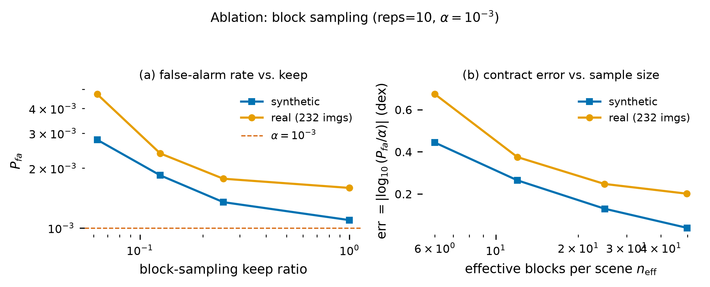{width=11cm}

**Table 10b　E9 标定样本量（真实）**

| n | 相对误差 mean | std |
|---|---|---|
| 16 | 0.0886 | 0.0810 |
| 64 | 0.0802 | 0.0573 |
| 128 | **0.0757** | 0.0618 |
| 200 | 0.1510 | 0.1291 |

> 注：n=200 误差反升系块抽样边界效应——标定场景数接近全量时，抽样块与测量块的重叠方差增大（底稿记录）；本文据此取 n=128 为标定规模。

Fig.26 给出该扫描的误差-带（mean±std，reps=10）：n=128 处于误差平台的最低段，n=200 的反升清晰可见，n=16–128 段样本量收益递减——为"标定集 128 图"的工程选择提供曲线依据。

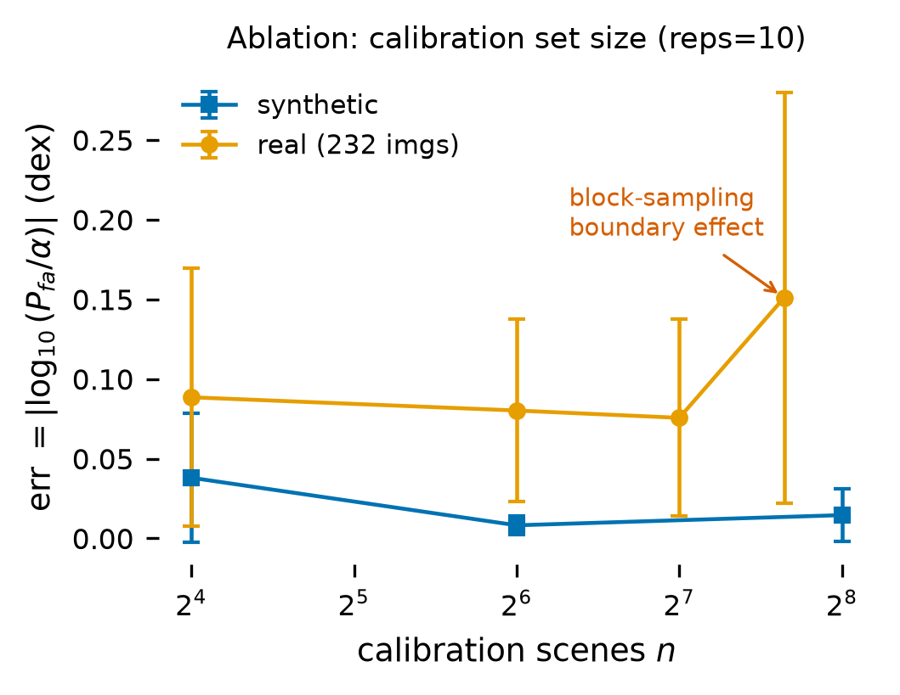{width=11cm}

**Table 10c　E9 逐场景 vs 全局标定（真实）**

| 方案 | $P_{fa}$ | $P_d$（单元级汇总） | 标定误差 err | 期望精度口径采用 |
|---|---|---|---|---|
| 逐场景 | $1.590{\times}10^{-3}$ | 0.1863 | 0.2014 | — |
| **全局** | $\mathbf{1.043{\times}10^{-3}}$ | 0.1828 | **0.0185** | ✓ |

> 注：本表 $P_d$ 为杂波/目标单元级汇总口径，与 Table 9 的框级 $P_d$（0.99）不可直接比较。
> 注：全局行 err=0.0185 dex（相对偏差仅 4.3%）**低于 §3.1.1 的有限样本噪声底**，系 λ 与测量在同一杂波池上标定（in-sample）所致的乐观偏差，应视为标定分辨率（整数分位数 B=4096）下的**下界**而非泛化精度；逐场景行 err 含跨场景泛化误差故大 10×。

→ **期望精度口径下全局模式占优**（err 低 10×，$P_d$ 仅差 0.0035），本文全局模式（式 3.2a）采用之。但这不是对逐场景模式的否定：逐场景模式以 err 0.201 为代价换取**条件误警率均衡与候选负载恒定**——E7 的 4.7–4.9× 负载抑制正来源于此。二者是 §3.1.1 定义的两个合法运行点，按部署瓶颈（期望精度 vs 负载/尾时延）二选一，不可读作"同一配置同时取得两个数字"。

**Table 10d　E9 合成项（items 1/2/8）**

| 项 | 关键结果 |
|---|---|
| 除法消除 divfree | $P_{fa}$ 漂移 0.0140 dex，判决不一致率 $1.69{\times}10^{-3}$ → **有效** |
| 零量化 zquant | 漂移 0.0124 dex → 有效 |
| 桶数 $B$=4096 | $\alpha$ 误差 0.084 dex，$\lambda$ 误差 $|\Delta z|=0.0059$ → **达标** |
| 标度指数 round / floor | 2.055 / 1.268（round 更符合 $\varepsilon^2$） |

> 注：items 1/2 依赖 $\mu/\sigma$ 结构留合成版；items 6/7 展开见 Table 10e/10f。

**Table 10e　E9 分数归一化 h0 消融（item 6，合成，SSDD 232）**

| 设置 | $R$（INT8/FP32） | $P_d@10^{-3}$（INT8） |
|---|---|---|
| $z=(s-\mu)/\sigma$（含 $h_0$） | 1.033 | 0.582 |
| 原始分数 $s$（去 $h_0$） | 0.917 | 0.178 |

> 注：去掉归一化后 $R$ 漂离 1 达 8.3%，INT8 与 FP32 的判决统计量跨配置不再可比——阈值搬运（E5）的前提失效；$P_d$ 崩塌 3.3×（−69%）。归一化是式 (3.2a) 前提 $h_0$ 成立的消融证据。

**Table 10f　E9 校准集分层消融（item 7，合成，压测集）**

| 校准集构成 | $s$ 饱和率（压测集均值） | $P_{fa}$ FP32 | $P_{fa}$ INT8 | $R$（INT8/FP32） |
|---|---|---|---|---|
| 分层（三海况） | **0.5%** | $1.00{\times}10^{-3}$ | $8.8{\times}10^{-4}$ | 0.881 |
| 只取平静 | 9.0% | $1.00{\times}10^{-3}$ | $2.7{\times}10^{-4}$ | 0.267 |

> 注：只用平静海况校准时阈值对粗糙海况欠覆盖——饱和率升至 9.0%（触碰 E2 饱和机理）、INT8 $P_{fa}$ 塌至 0.27$\alpha$（过度保守，$P_d$ 受损）；分层校准在两类压测下均保持覆盖。本文 calmA/roughB 双校准集设计即源于此。item 7 系 E2 阴性背景下的降权证据，但其结论直接指导校准集构成选择。

Fig.27–28 补充方法核心设计的消融曲线（数据见 Table 10e/10f）。**Fig.27(a)（分数归一化 h0）**：去掉 $z=(s-\mu)/\sigma$ 归一化、直接在原始分数 $s$ 上标定阈值时，跨配置比值 $R$ 从 1.033 漂移至 0.917，且 $P_d@10^{-3}$ 从 0.582 崩塌至 0.178（合成，SSDD 232）——归一化使判决统计量跨配置/跨场景可比，是阈值搬运前提的消融证据。**Fig.27(b)（校准集分层）**：只取平静海况校准使压测集饱和率升至 9.0%、INT8 $P_{fa}$ 塌至 0.27$\alpha$，分层（三海况）两端保持覆盖——calmA/roughB 双校准集设计的直接依据。**Fig.28（标度与取整方向）**：(a) $|\Delta\ln P_{fa}|$ 对 $\varepsilon_\sigma$ 的 log-log 拟合，斜率 $\approx2$ 印证式 (3.19) 的 $\sigma$ 项二次主导；(b) round 与 floor 两种取整方向的 $\Delta\ln P_{fa}$ 对照，round（2.055）更贴近 $\varepsilon^2$ 标度。

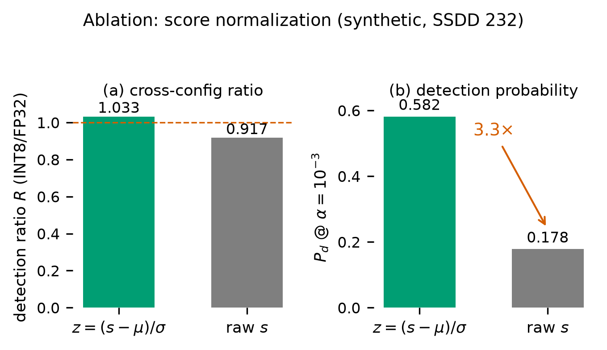{width=11cm}

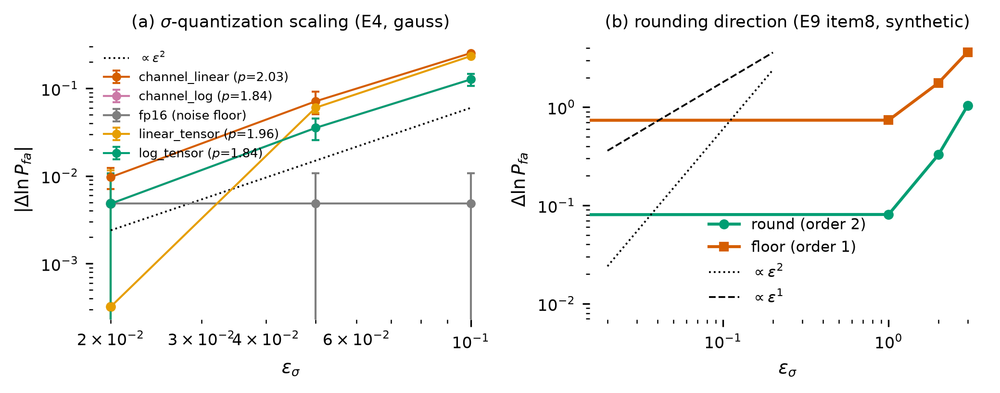{width=11cm}

Fig.29 将上述四项消融的关键对照数字汇总为一张 1×4 对比柱状图（各面板均以完整方法为参照）：**(a) 块抽样 keep 比**——keep 从 1.0 降至 0.0625 时 $P_{fa}$ 从 $1.59{\times}10^{-3}$ 单调抬升至 $4.72{\times}10^{-3}$（红色=偏离 $2\alpha$ 容差），柱顶白字标注有效块数 $n_{\mathrm{eff}}$ 从 49.8 压缩至 6.0——err 恶化与有限样本秩涨落同步；**(b) 标定样本量**——$n\in\{16,64,128,200\}$ 的契约误差 mean±std 误差柱：n=128 处于平台最低段（0.0757），n=200 反升至 0.151、n=16 最差 0.0886 但方差最大；**(c) 全局 vs 逐场景标定**——$P_{fa}$ 柱以契约误差入标签（0.201 vs 0.018）：逐场景重标定将 err 压缩一个量级，但需目标域数据；完整方法（逐场景模式）与全局模式的差距即"免数据搬运"要付出的标定成本；**(d) 校准集分层（合成）**——分层（三海况）INT8 $P_{fa}$ $8.83{\times}10^{-4}$ 紧贴 FP32 参考线 $1.00{\times}10^{-3}$（$R=0.881$），只取平静海况则塌至 $2.68{\times}10^{-4}$（$R=0.267$，过度保守）——校准集覆盖度直接决定跨场景守约性。

{width=16cm}

Fig.35 把 E9 消融中**最能支撑方法设计的三个对照**集中为一张 2×2 对比图（数字与 Table 10c/10e/10f 同源）：**(a) 分数归一化 $h_0$（item 6）**——含 $h_0$（$z=(s-\mu)/\sigma$）与去除 $h_0$（原始分数 $s$ 直接阈值）的 $R$ 与 $P_d@10^{-3}$ 双柱并列：$R$ 1.033 vs 0.917、$P_d$ 0.582 vs 0.178，两指标同向崩塌——归一化同时是"跨配置可比"（E5 搬运前提）与"检测力"的必要件；**(b) 校准集分层（item 7）双轴对照**——饱和率（左轴，紫）0.5% vs 9.0% 与 INT8 $P_{fa}$（右轴，棕，$\times10^{-4}$）8.8 vs 2.7：只取平静海况校准时饱和与过度保守（$P_{fa}$ 塌至 0.27$\alpha$）同时出现，饱和率与守约性并非独立症状而是同一覆盖度缺陷的两面；**(c) 分层消融的 $R$ 对比**——分层 0.881 落在 $R=1\pm20\%$ 契约带内、只取平静 0.267 远离带宽，$\pm20\%$ 阴影带即 §4.1.4 的验收容差；**(d) 全局 vs 逐场景标定误差（真实数据，item 5）**——err 0.0185 vs 0.2014（log 轴）相差一个量级，0.05 dex 参考线（有限样本噪声底）下全局模式的 in-sample 优势清晰可见（口径注见表 10c），而 $\Delta P_d$ 仅 0.0035——精度优势不以牺牲检测力为代价。Fig.27–29 给出各单项的曲线细节，Fig.35 提供三项关键消融的并排总览，便于读者一图核对"每个设计选择拿掉后塌多少"。

{width=16cm}

---

## 4.12 定性可视化与场景类型分析（远洋/近岸 / Fig.30–Fig.38）

**动机与分类协议。** E7 的负载解耦证据按海况分桶给出；本节补充第二个人工可判读的难度维度——**远洋（offshore）vs 近岸（nearshore）**：近岸场景含海岸线与陆地，检测器分数图上出现大块强响应杂波，是误警与候选负载的另一压力源。本地 SSDD 发布未保留官方 inshore/offshore 标注，我们采用可复现的两步协议重新划分 232 张测试图：①计算陆地各向异性分数 coast_score（图像行均值与列均值的标准差之和，陆地大块亮/暗结构产生强各向异性）；②按分数排序生成缩略拼版人工确认。TOP-40（coast_score 中位数 41.9）均含明显海岸线/陆地，rank 49–96 复核为开阔海面，故取 TOP-40 为近岸、其余 192 张为远洋（划分资产 `code/results/e7/e7_scene_type.csv`）。交叉核对：近岸集中于 medium/rough 海况桶（4/36/0），远洋为 31/138/23，两维度（海况 × 场景类型）近似正交，可分别归因。

**定性结果（Fig.30 / Fig.31）。** Fig.30 与 Fig.31 分别给出近岸（001111/001091/001159）与远洋（000739/001149/001121）典型帧的检测框可视化（绿 = GT，橙 = INT8 检出，上下两行分别为 calmA / roughB 校准集）：INT8 在近岸陆地杂波下仍能检出主要目标，但可观察到校准集差异对近岸帧检出框的影响大于远洋帧——与 E5 设置 1（换校准集搬运）的定量结论互为印证。
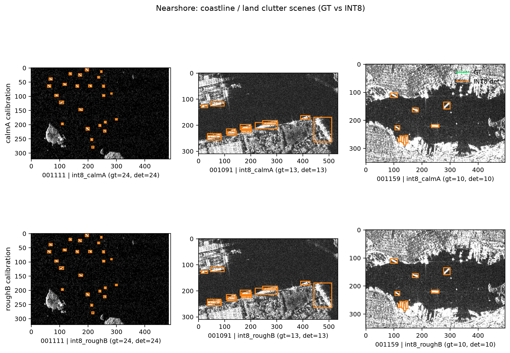{width=16cm}

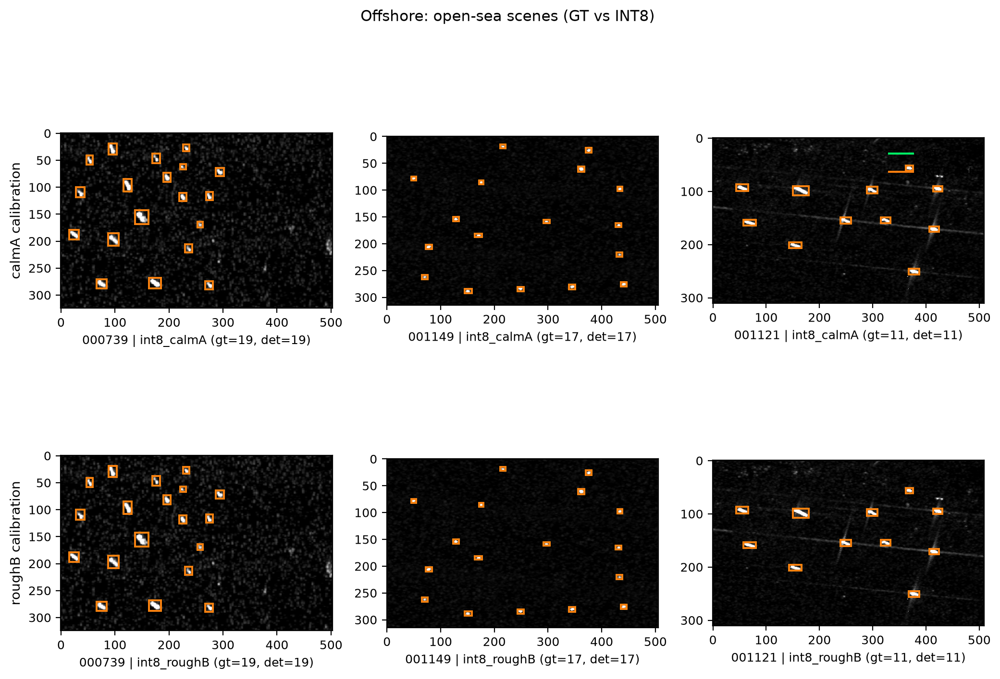{width=16cm}

**分数图证据（Fig.32）。** Fig.32 将 P3 objectness 热力图（去 letterbox 对齐，alpha 混合）叠加于原始图像：近岸帧在陆地/海岸线区域出现大面积高响应，而船位响应与陆地响应幅值可比——这正是逐帧 $P_{fa}$ 在近岸子集违约率更高的机理来源；远洋帧高响应区基本只出现在船位及其尾迹。
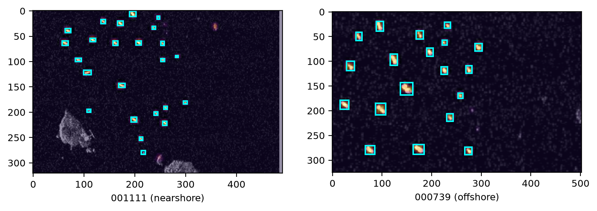{width=16cm}

**定量复核（Fig.33 与 Table 8b 口径一致）。** Fig.33 给出三面板证据：(a) 逐帧 $P_{fa}/\alpha$ 按场景类型着色——INT8-全局运行点在近岸子集 $>2\alpha$ 违约率 **20.0%**（8/40），约为远洋子集 **9.9%**（19/192）的两倍，$>5\alpha$ 分别为 2.5%/1.6%；(b) 候选负载箱线——近岸 p90 = 20.5 vs 远洋 15.9（中位数 5 vs 6，近岸尾部更重）；(c) 海况 × 场景类型构成。**QCert 运行点在两个子集上均恒为 1.07$\alpha$、零违约**——把 §4.9 的"海况耦合"证据扩展到"场景类型耦合"维度：无论难度来自海况还是陆地杂波，分位数校准阈值都保持契约，而全局阈值在两类压力下都出现尾部违约。
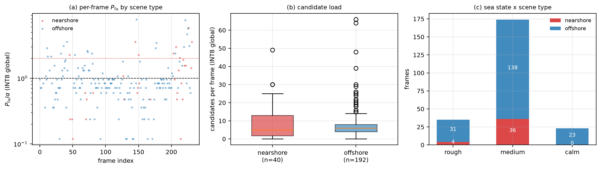{width=16cm}

> 注：近岸/远洋划分系人工确认的可复现协议产物（非 SSDD 官方标注），样本量 $n_{nearshore}=40$，$>5\alpha$ 违约仅 1 例，尾部结论以 $>2\alpha$ 口径为主。

**分布级对比（Fig.34）。** Fig.33 的散点/箱线给出尾部点证据，Fig.34 进一步给出**四个分布级 ECDF/直方图对比**：**(a) INT8-全局运行点的逐帧 $P_{fa}/\alpha$ ECDF**——近岸曲线（红）整体右移，$>2\alpha$ 违约 20.0% vs 远洋 9.9% 在图上表现为 ECDF 末端落在红色虚线右侧的余量差；**(b) INT8-QCert 运行点同口径 ECDF**——两个子集的曲线几乎重合且全部收敛于 $1.07\alpha$（黑虚线右侧极窄区间），分布级直接呈现"分位数校准把两类场景拉回同一守约分布"；**(c) 候选负载 ECDF**——近岸曲线在全分位段右移（中位数 5 vs 6 之外，上分位差距更明显），p90 = 20.5 vs 15.9；**(d) coast_score 分布直方图**——近岸（红）与远洋（蓝）近似双峰分离，TOP-40 分界线（29.3）落在两峰之间的谷地，直观解释了该划分协议为何只需一个标量阈值。

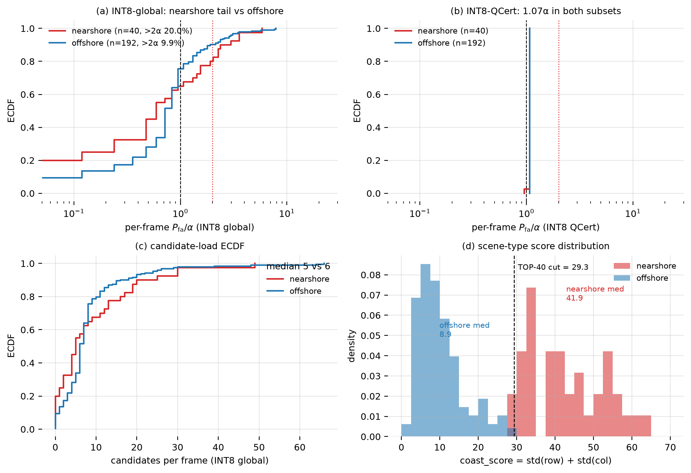{width=16cm}

**逐帧对照 gallery（Fig.37）。** Fig.30/31 按场景类型各给一组典型帧，Fig.37 把两类场景**并排放入同一图内直接对照**，并在每帧标题标注该帧的实测 $P_{fa}/\alpha$（INT8-全局）与候选数：上排近岸（001131：5.83$\alpha$、cand=49；001159：3.57$\alpha$、cand=30；001039：2.98$\alpha$、cand=25；001111：1.55$\alpha$、cand=13）——陆地/海岸线杂波下 $P_{fa}$ 普遍越线、候选负载为远洋合规帧的 10 倍量级；下排远洋（001149：0.60$\alpha$、cand=5；000109：0.36$\alpha$；000249：0.24$\alpha$）大多低于 $\alpha$，但 **000739（7.86$\alpha$、cand=66）作为远洋尾部离群帧**同样出现高违约——说明远洋 9.9% 的尾部违约并非陆地杂波所致，而是强船迹/尾迹类强响应（机理见 Fig.38 右下图）。两类场景的检出框（橙）与 GT（绿）均贴合，$P_{fa}$ 差异不来自漏检而来自背景响应结构。

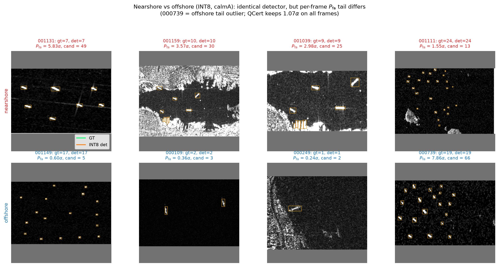{width=16cm}

**热力图 gallery（Fig.38）。** Fig.32 的 1×2 叠加图扩展为 2×2 共享色标 gallery：近岸帧（001111/001159）在整段海岸线与陆地区域出现**成片高响应**（与船位响应幅值可比），远洋帧（001149）的响应基本只出现在船位及尾迹、背景干净；000739 则显示**强尾迹响应**——远洋尾部违约（Fig.37 右下图）的机理来源：无陆地杂波的场景中，大幅船迹成为分数图上的第二强响应源。四图共享同一 colorbar，近岸"陆地响应带"与远洋"仅尾迹响应"的对比在统一色标下不可辩驳。

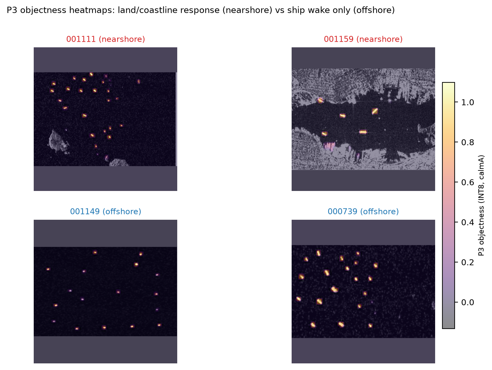{width=16cm}

---

## 4.13 实验总判定与创新点映射

**Table 11　E0–E9 总判定**

| 实验 | 数据源 | 判定 | 支撑创新点 |
|---|---|---|---|
| E0 存在性 | 真实板级 | $R$ 判据 NO-GO，mAP pass | 动机：mAP 与 $P_{fa}$ 解耦 |
| E1 误差界 | 合成 | **PASS**（界全成立） | **C1 理论可信** |
| E2 饱和 | 合成 | WEAK（阴性：int32 不截断） | 反向加强契约叙事 |
| E3 板/仿真一致 | 板级 | **A1 成立**（bit-exact） | 整数确定性地基 |
| E4 传播 | 合成 | 标度律✓ / P1✗ | Prop.2 标度支撑 |
| **E5 阈值搬运** | **板级实测** | **PASS（设置1/2）** | **C1 核心：免数据搬运** |
| **E6 热稳态** | **板级 40min 重放** | **PASS（P99 跨窗极差 0.69%/1.76%，逐窗 headroom 2.2–2.6%；$P_{fa}$ 恒定系重放必然，已降级为 sanity）** | **C3：热稳态下判决/时延稳定** |
| E7 负载耦合 | 板级 | **PASS（4.67×/4.93×，$n_{rough}=35$）** | **C3：候选负载抑制（host-free）** |
| E8 检测兼容 | 板级 | **PASS（PD 无损，7×CFAR）** | 兼容性 |
| E9 消融 | 真实+合成 | 期望精度口径全局最优（两模式分工） | 方法论有据 |
| E7+ 场景类型复核（§4.12） | 板级（近岸 40 / 远洋 192） | 近岸 $>2\alpha$ 20.0% vs 远洋 9.9%，QCert 两类零违约（Fig.33–34 / 37–38） | C2/C3 交叉维度佐证 |

### 创新点 → 证据 → 性能提升

1. **C1 免数据阈值搬运（最强创新）**：E5 设置1/2 板级 PASS。搬运 $P_{fa}$ 贴近 $\alpha$（漂移 0.046–0.111），而不换算漂移最高 **300×**（设置2）。**这是浮点 GPU 流水线上无从定义的能力**（无整数格点承载阈值映射，A1+A3 合取不成立，§3.6.1）。
2. **C2 整数判决层**：E3 bit-exact 率 1.0、E9 除法消除有效、判决层 $0.024$ ms host-free（host 仿真上界，§4.9 测量口径）。
3. **C3 板级独有测量**：E6 40 min 连续负载下 P99 跨窗极差 **0.69%（INT8 复跑）/ 1.76%（FP16 带传感器，温度 51.7–53.5 °C 时延不涨）**（$P_{fa}$ 恒定为重放必然，如实降级为 sanity 检查）；E7 粗糙海况候选负载 **降 4.7–4.9×**（$n_{rough}=35$）、INT8 提速 **1.31×**、单船能耗 0.239 J。
4. **兼容性**：E8 $P_d$ 无损、$R=1.0$、mAP 仅降 0.29 点、$P_d$ 超 CA-CFAR **7×**。
5. **理论界**：E1 全档 bound_holds + E4 $\Delta\ln P_{fa}\sim\varepsilon^2$ 标度律。

### 需在论文中如实处理的薄弱点

1. **E0 $R$ 判据 NO-GO**：$R=0.969<1$（CI 含 1）→ 表述为"量化本身基本安全"，转向搬运主张；不夸大存在性。
2. **E2 WEAK**：score 层 int32 不截断（阴性），饱和非主导 → 不作主张，E9 item7 降权。
3. **E4 P1 未全过**：5× 改进判据不成立 → Prop.2 "$\sigma$ 主导"论断修正为标度律 + 经验界。
4. **E5 设置 3 未执行**：无 GF-3 数据 → limitation，跨传感器留后续。
5. **E6 频率列 NaN**：CANN 7.0.RC1 对 310B 不提供读数 → 以时延稳定性佐证无降频；且 E6 为固定帧重放，$P_{fa}$ 恒定性不构成独立证据，已如实降级（§4.8）。
6. **E7 负载抑制比的适用面**：负载抑制比仅实测于 rough 子集（$n_{rough}=35$，`SeaStateBucketer` 透明分桶）→ §4.9 已声明，不推广为全海况守恒律。
7. **E8 各行独立标定**：Table 9 的 $P_{fa}$ 一致性是 per-row 重标定结果；跨配置阈值复用由 E5 设置 2 承担。CA-CFAR 为未调优 strawman（guard=2/train=8），仅作数量级对照。
8. **E9 全局标定 err 为 in-sample 下界**：0.0185 dex 含标定-测量同池乐观偏差，绝对值不可外推为泛化精度（§4.11）。
9. **E7 与 E9 的模式口径**：E7 的负载抑制（4.7–4.9×）来自逐场景模式，E9 的标定精度（err 0.0185）来自全局模式——二者是 §3.1.1 定义的同一契约的两个运行点，期望精度与负载均衡不可兼得（err 0.0185 vs 候选恒定），部署按瓶颈二选一，不可读作"同一配置同时取得两个数字"。
